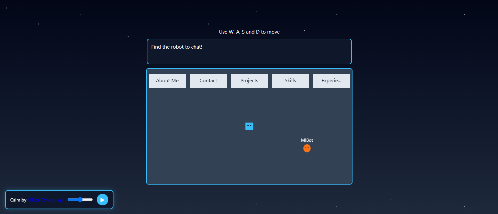

My Epic Website!

My portfolio website where you explore the site instead of clicking on links!~

My very own website!~~~ It's gonna grand~ It's gonna be new~ It's gonna be mine!~ I really wanted something that isn't boring and decided on a very game like approach with a little character you control to find and select the options you wanna see <3

This would be the first time I tried doing something like this in HTML and honestly, I'm satisfied with it~ and I'm going to make more in the future!

Note:

AI was used for me to better understand how to implement canvases and movable characters

Controls:

WASD to move and E to interact

Psst! Go check out MIBot, they got a lot to say!~

You can try the website out here: https://steelyxepic.github.io/My-Epic-Website/

Music by <a href="https://pixabay.com/users/leberch-42823964/?utm_source=link-attribution&utm_medium=referral&utm_campaign=music&utm_content=589817">Nikita Kondrashev</a> from <a href="https://pixabay.com/music//?utm_source=link-attribution&utm_medium=referral&utm_campaign=music&utm_content=589817">Pixabay</a>
